<a href="https://gt2rz.dev">
  
</a>

<br />

**Convierto ideas en productos digitales.** Diseño, construyo, despliego e itero: de la primera entrevista con quien tiene el problema hasta el producto en manos de usuarios reales. Cada detalle importa, y trabajo potenciado con IA.

<details>
<summary><b>🇬🇧 In English</b></summary>
<br />

I'm a **product developer**: I turn ideas into digital products. I discover the problem, design the solution, build it in small weekly deliveries and launch it — then measure and iterate. Below are the products I've shipped or prototyped; every one of them is live at [gt2rz.dev](https://gt2rz.dev).

</details>

<p>
  <a href="https://gt2rz.dev"></a>
  <a href="https://gt2rz.dev"></a>
  <a href="https://gt2rz.dev/proyectos"></a>
</p>


## 02 / Proyectos

<table>
  <tr>
    <td width="44%"><a href="https://warehouse-3d-scada.gt2rz.dev/">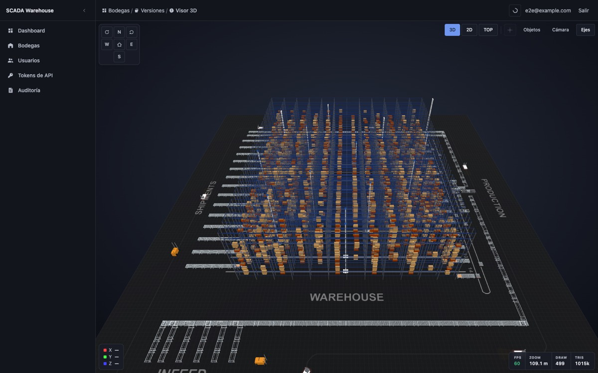</a></td>
    <td>
      <a href="https://warehouse-3d-scada.gt2rz.dev/"></a>
      <p>SCADA de bodegas: un editor 2D para diseñar el layout y un visor 3D que lo muestra con inventario y telemetría de vehículos en vivo.</p>
      <p><sub><i>Warehouse SCADA: a 2D layout editor and a live 3D viewer with inventory and vehicle telemetry.</i></sub></p>
      <sub><code>Vue</code> <code>Three.js</code> <code>Fastify</code> <code>WebSockets</code> <code>PostgreSQL</code></sub>
    </td>
  </tr>
  <tr>
    <td>
      <a href="https://mailcrafter.gt2rz.cloud/"></a>
      <p>Editor visual de plantillas de email para equipos: bloques, variables con valores de ejemplo y HTML con los estilos en línea, listo para Gmail, Outlook y Apple Mail, con vista previa aislada, envío de prueba e historial de versiones.</p>
      <p><sub><i>Visual email template editor for teams: drag-and-drop blocks, safe variables and inlined HTML for Gmail, Outlook and Apple Mail, with sandboxed preview, test sends and version history.</i></sub></p>
      <sub><code>Laravel</code> <code>Inertia</code> <code>Vue</code> <code>GrapesJS</code> <code>PostgreSQL</code></sub>
    </td>
    <td width="44%"><a href="https://mailcrafter.gt2rz.cloud/">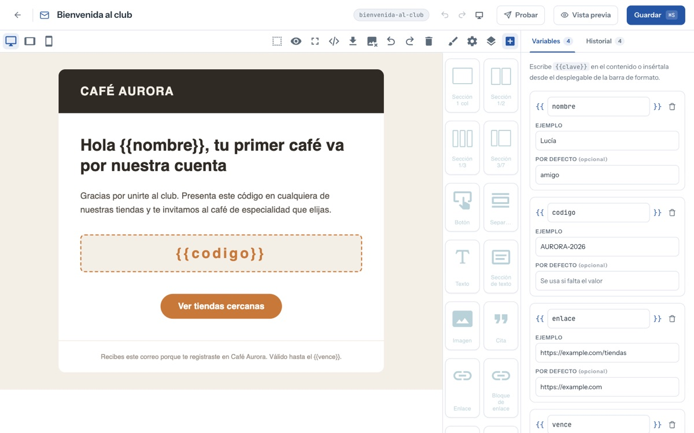</a></td>
  </tr>
  <tr>
    <td width="44%"><a href="https://h3-demo.gt2rz.dev/">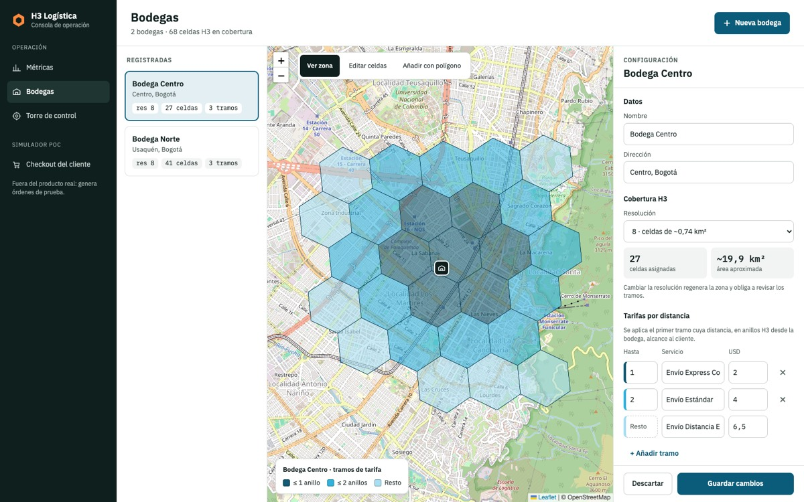</a></td>
    <td>
      <a href="https://h3-demo.gt2rz.dev/"></a>
      <p>Consola logística de un e-commerce: dibujas la zona de cada bodega en celdas hexagonales H3 y el checkout resuelve al instante qué bodega atiende una dirección y cuánto cuesta el envío.</p>
      <p><sub><i>E-commerce logistics console: warehouse zones indexed as H3 hexagons, instant fulfilment and shipping cost at checkout.</i></sub></p>
      <sub><code>Vue</code> <code>Leaflet</code> <code>h3-js</code> <code>NestJS</code> <code>PostgreSQL</code></sub>
    </td>
  </tr>
  <tr>
    <td>
      <a href="https://workout-gym-tracker.gt2rz.cloud/"></a>
      <p>Tracker de gimnasio en app móvil y web: rutina semanal con series y pesos objetivo, registro de cada sesión y seguimiento de peso, pasos y medidas, sobre una API con sesiones protegidas por DPoP.</p>
      <p><sub><i>Gym tracker for mobile and web: weekly routines, session logs and body metrics on one DPoP-secured API.</i></sub></p>
      <sub><code>Expo</code> <code>React Native</code> <code>Astro</code> <code>NestJS</code> <code>Prisma</code></sub>
    </td>
    <td width="44%"><a href="https://workout-gym-tracker.gt2rz.cloud/">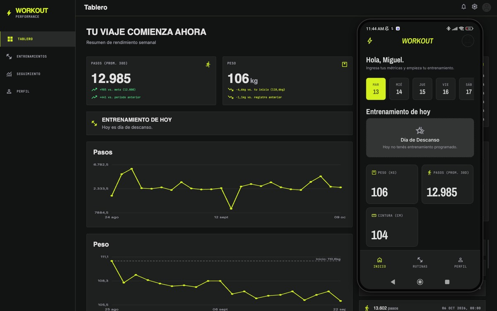</a></td>
  </tr>
  <tr>
    <td width="44%"><a href="https://json-formatter.gt2rz.dev/">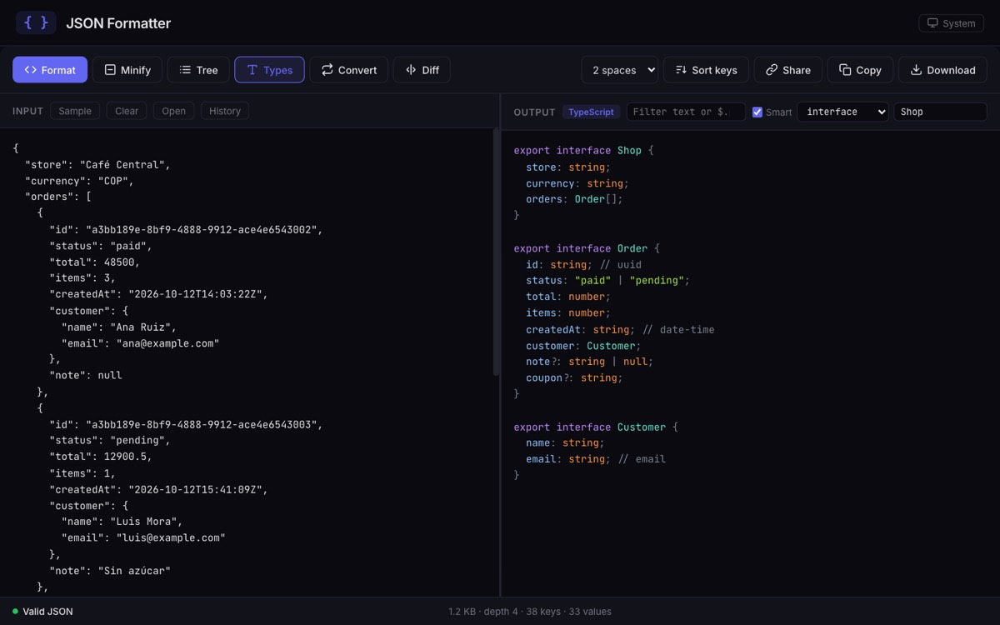</a></td>
    <td>
      <a href="https://json-formatter.gt2rz.dev/"></a>
      <p>Valida, repara y formatea JSON sin que salga del navegador: árbol, diff entre versiones y tipos en TypeScript, Zod, Go, Python y Rust.</p>
      <p><sub><i>Validate, repair and format JSON locally: tree view, diff, and generated types for TypeScript, Zod, Go, Python and Rust.</i></sub></p>
      <sub><code>TypeScript</code> <code>Web</code> <code>Local-first</code></sub>
    </td>
  </tr>
  <tr>
    <td>
      <a href="https://adoptme.gt2rz.dev/"></a>
      <p>Landing de un refugio que cuenta con el scroll la historia de Mateo y Mía: un cuaderno a lápiz bajo la lluvia que se colorea al adoptarlos.</p>
      <p><sub><i>A shelter's landing page told by scroll: a pencil sketchbook in the rain that fills with colour once they're adopted.</i></sub></p>
      <sub><code>Astro</code> <code>GSAP</code> <code>Three.js</code> <code>SVG</code></sub>
    </td>
    <td width="44%"><a href="https://adoptme.gt2rz.dev/">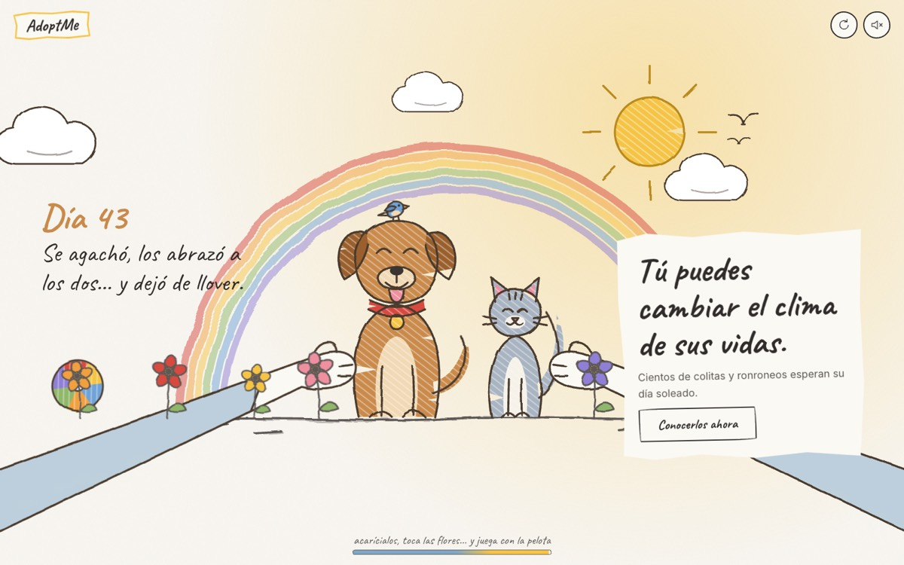</a></td>
  </tr>
</table>

<p align="right"><a href="https://gt2rz.dev/proyectos">Ver todos en gt2rz.dev/proyectos →</a></p>

## 03 / Cómo lo construyo


| Paso | Qué recibes |
| --- | --- |
| **01 · Descubrir** | Entiendo el problema, a quién le duele y cómo sabremos que está resuelto. |
| **02 · Diseñar** | Flujos y un prototipo navegable que se prueba con usuarios antes de escribir código. |
| **03 · Construir** | Entregas semanales, pequeñas y medibles, con tests y rendimiento desde el principio. |
| **04 · Lanzar** | En producción, con analítica, y lo aprendido vuelve al producto. |

## 04 / Stack

```text
front   TypeScript · Astro · Vue · React Native (Expo) · Three.js · GSAP · Tailwind
back    NestJS · Fastify · Go · Laravel · PostgreSQL · Prisma · WebSockets
infra   Docker · Cloudflare · GitHub Actions
```

## 05 / En números

<p>
  
  
</p>

<sub>Generadas a diario por <a href=".github/workflows/stats.yml">una GitHub Action</a> con <a href="scripts/stats.mjs"><code>scripts/stats.mjs</code></a>: si la API falla, se conserva la última versión.</sub>


<p align="center">
  <b>Suelta la canica: así llevo una idea hasta producto.</b><br />
  <a href="https://gt2rz.dev">Cuéntame tu producto en gt2rz.dev →</a>
</p>
